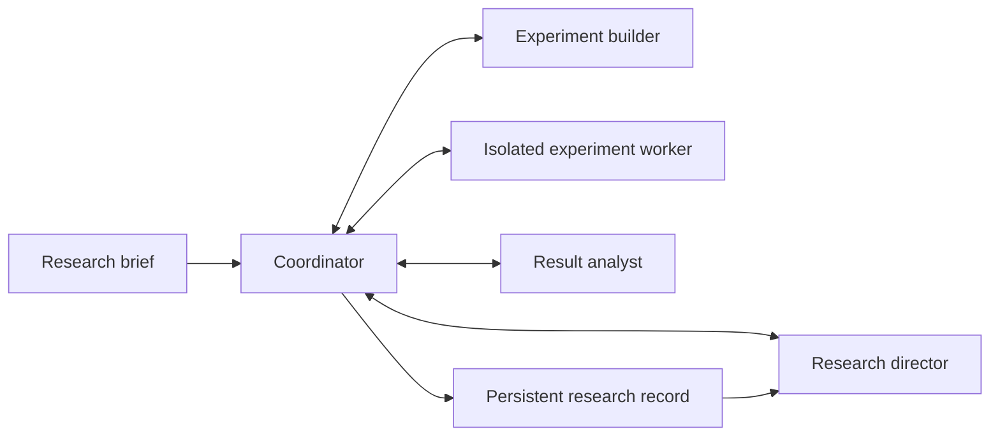

# Autonomous Research Lab — system design and development plan

This document describes planned behavior, not implemented functionality or demonstrated research performance. See [README.md](README.md) for the project introduction.

**The central design decision: the system manages an ongoing research program, not a collection of disconnected prompts or experiment runs.** Every new experiment starts from the research goal and accumulated findings.

## 1. What the user gives the system

The starting point is a **research brief** containing:

- **The goal:** What question or area should it investigate?
- **The scope:** What kinds of work are permitted?
- **Available resources:** Datasets, compute, models, software, and source access.
- **Limits:** Execution time, model usage, storage, and other resource constraints.
- **Any required outcomes or constraints:** For example, an approach must remain usable on a particular device.

The brief does not need to specify the experiments. Designing those is the system's job.

Once started, the system should make routine research decisions autonomously. The user can inspect, pause, or stop it without having to approve each experiment.

If an interesting direction requires resources or permissions outside the brief, the system records the proposed direction. It does not silently expand its authority.

### Initial hardware allocation

Allocate one RTX 6000 Pro to experiment execution. Planning and implementation assume this GPU is available; there is no separate hardware-readiness or model-server-shutdown milestone.

Record its actual memory capacity and the host's resource limits during execution setup rather than inferring capacities from the product name.

## 2. A concrete research scenario

Consider this example goal:

> Find out how to make a small image classifier handle unfamiliar image noise while preserving its performance on clean images.

This is an illustration of the workflow, not a claim that the example is novel or that these experiments have been run.

### Establish the starting point

The system reads relevant sources and examines the available dataset and training environment.

It needs to establish:

- How the baseline classifier behaves.
- Which kinds of noise are already covered by existing approaches.
- Which comparisons would answer the question.
- How clean-image performance and noise robustness will be measured.

It then produces a saved experimental design. That design names the conditions being compared, the data splits, measurements, and analysis.

The baseline is not merely something to beat. It establishes whether the experiment behaves sensibly enough to investigate the question.

### Run an initial experiment

Suppose the first design compares ordinary training against training with added image noise.

The system generates the implementation, runs it, and collects results for the prescribed conditions.

Now suppose the results show this pattern:

- Training with one noise distribution helps on similar noise.
- The benefit does not extend to another noise distribution.
- Clean-image performance changes little.

Those are hypothetical observations. The system must not immediately conclude that it has discovered a generally robust training method.

### Choose a follow-up

The results suggest several possible next experiments:

- Test whether the effect depends on similarity between training noise and evaluation noise.
- Test whether the amount of noise, rather than its type, explains the difference.
- Try a change to the training approach motivated by the observed limitation.

These are different questions. The system should generate and compare them, not automatically choose the easiest parameter change.

For each candidate, it must explain:

- Which observation motivates it.
- What question it would answer.
- What outcomes would distinguish the proposed explanations.
- What it would require to execute.
- Why it deserves priority over the alternatives.

### Handle a failed experiment

Suppose the next implementation crashes before producing measurements.

That is an execution failure, not evidence against the research idea.

The system may repair the implementation within its remaining budget. The failed attempt stays in the record. If the repair changes the scientific procedure—not merely the broken code—the experimental design must be revised explicitly.

If the experiment runs correctly but does not resolve the question, the system records an inconclusive result. It does not keep changing the experiment until it obtains the desired answer.

### Continue or stop

Further results might justify another experiment, a different explanation, or a related research direction.

The system stops when it reaches its resource limits, encounters an unresolved blocker, satisfies the brief's completion criteria, or cannot identify a justified next experiment within the remaining resources.

Its final report includes what was learned, what remains unresolved, and why it stopped.

**This sequence must emerge from the results. The research controller must not hardcode this example's experiments or decisions.**

## 3. Architecture: ordinary software controls the workflow

The proposed architecture is a Python research engine with:

- SQLite for structured state.
- Filesystem storage for code, datasets, logs, and results.
- A command-line interface before a browser interface.
- Isolated Linux workers for generated experiment code.
- Configurable model endpoints, with assignments recorded for each research program.

The language models propose scientific decisions and implementations. Ordinary application code controls permissions, resource allocation, state changes, and execution.

That separation prevents a model's statement—such as "the experiment succeeded"—from becoming an authoritative system event.

These are responsibilities, not a requirement to run a separate model for every box.

### Component contracts

| Component | Responsibility | Input and output |
|---|---|---|
| **Coordinator** | Own the workflow, enforce limits, dispatch work, and commit state changes. | Accepts a research brief and advances the recorded program. |
| **Research director** | Decide what to investigate, compare candidate experiments, and choose the next action. | Research context → a structured decision with reasons and references. |
| **Experiment builder** | Implement a selected experimental design without silently changing its question or procedure. | Design + execution environment → code bundle and execution requirements. |
| **Experiment worker** | Run the bundle in an isolated environment and capture what happened. | Bundle + resource allocation → execution record and artifacts. |
| **Result analyst** | Interpret measurements against the design, identify limitations, and propose unresolved questions. | Design + execution records + results → analysis with evidence references. |
| **Source tools** | Search literature and retrieve permitted material. | Search/read request → source content, identifiers, and retrieval details. |
| **Research store** | Preserve designs, attempts, findings, decisions, and relationships. | Validated records and artifacts → stable references available to later work. |

The director, builder, and analyst can initially use the same underlying model with different instructions and context. Separate roles do not automatically provide independent scientific judgment.

Reporting is a view of the research record. It should not be another authority that rewrites the history to make a better story.

## 4. How the director makes decisions

This is the part that turns an experiment runner into an autonomous research system.

### What it receives

At each decision point, the director receives a bounded context containing:

- The research brief and remaining resources.
- The current question.
- Relevant sources and prior findings.
- The latest experiment and its analysis.
- Important contradictory or negative findings.
- Previously attempted and rejected directions.
- Outstanding questions and dependencies.

It can request additional records or source material. The system should not rely exclusively on a running prose summary: summaries can omit details that later become important.

### What it can do

The director can:

- Gather more information.
- Propose experimental designs.
- Select a design for execution.
- Revise or close a research question.
- Open a related question within scope.
- Finish the program with a stated reason.

It cannot directly change resource permissions, erase previous results, or execute commands on the coordinator's host.

### What an experiment proposal contains

Each candidate design must specify:

1. **Question:** What are we trying to learn?
2. **Motivation:** Which sources or previous observations justify it?
3. **Procedure:** What changes, what remains fixed, and what comparisons are needed?
4. **Measurements:** What will be recorded?
5. **Interpretation:** What would different outcomes mean?
6. **Requirements:** Data, software, compute, and dependencies.
7. **Relationship to previous work:** Is this a new question, a deliberate replication, or a revision?

A statement such as "try a larger model" is not a complete experimental design.

### Initial selection policy

Start with a small shortlist—up to three materially different candidates when useful alternatives exist.

The coordinator first removes candidates that exceed permissions or cannot be executed with available resources.

The director then compares the remaining candidates using explicit questions:

- Does this address an important unresolved part of the research goal?
- Would the possible outcomes be informative?
- Is a missing comparison preventing us from interpreting existing results?
- Does the proposal build on evidence, or merely repeat an earlier attempt?
- Is its likely contribution worth its execution cost?

The decision record includes the selected candidate and why the alternatives were not selected.

**Initially, this is a reasoned model decision, not a supposedly calibrated mathematical score.** Later evaluation can compare it against other selection policies. The system should not label an LLM's enthusiasm "expected scientific value" and treat the number as objective.

This policy also avoids making a numerical performance target the automatic winner over every explanatory question.

## 5. What the system remembers

The research record must preserve more than the latest successful code and a summary.

### Records

| Record | Essential contents |
|---|---|
| **Research program** | Goal, scope, resource permissions, budget, model assignments, and current state. |
| **Research question** | The question, why it matters, its parent question if any, and its current status. |
| **Source** | Citation or identifier, retrieved content, retrieval date, and whether the system read full text or only an excerpt. |
| **Experimental design** | Versioned procedure, conditions, data references, metrics, analysis plan, and expected resource needs. |
| **Implementation** | Code, dependency/environment information, and the design version it implements. |
| **Execution attempt** | Worker, implementation version, seeds/settings, timing, resource usage, completion status, and output references. |
| **Finding** | An observation or interpretation, its supporting evidence, conflicting evidence, and applicable conditions. |
| **Decision** | Considered alternatives, selected action, reasons, and the evidence available when the decision was made. |

### Important distinctions

**Execution status and scientific outcome are separate.**

A run may complete successfully while producing a result that contradicts the hypothesis. Conversely, a crashed run normally provides no answer to the scientific question.

**Measurements and interpretations are separate.**

A measured accuracy belongs to an execution record. "This suggests the model learned noise-specific features" is an interpretation linked to those measurements.

**Past designs and results are not overwritten.**

Corrections create new versions or annotations. Later findings can change how earlier results are interpreted without changing what originally happened.

**Repetition is not automatically a mistake.**

An identical configuration may be an intentional replication. The decision record must say why it is being repeated.

### Artifacts and interfaces

Large material—code, datasets, plots, logs, model outputs—lives in artifact storage. Database records refer to artifacts by stable identifiers and content hashes.

Records passed between components use validated JSON structures. For example:

- `Decision` identifies an action, its rationale, and referenced evidence.
- `ExperimentBundle` identifies a design, executable entry point, dependencies, and expected outputs.
- `RunResult` identifies an attempt, its status, measured resource usage, and artifacts.
- `Analysis` identifies observations, supported interpretations, limitations, and proposed next questions.

This gives each component an explicit contract instead of relying on another agent to interpret arbitrary chat text.

## 6. Execution, resource control, and recovery

### Isolated execution

Generated research code should run in a dedicated Linux VM or equivalent isolated worker, not directly inside the coordinator process.

The worker receives:

- The experiment bundle.
- Read-only access to the approved input data.
- A writable experiment workspace.
- Explicit CPU, memory, GPU, storage, and time allocations.

Credentials and the main research database remain outside that environment. Network access is disabled or restricted according to the research brief.

A subprocess timeout alone is not an adequate isolation boundary.

The precise isolation mechanism must be implemented before unattended code execution is enabled. It should not be postponed until after the research agents work.

### Resource accounting

Before launching work, the coordinator reserves the required allocation. Afterward, it records actual usage and releases unused capacity.

The budget includes:

- Successful experiments.
- Failed experiments.
- Implementation attempts.
- Model calls.
- Any additional evaluation runs.

The system does not obtain a free reset by declaring an attempt unsuccessful.

Execution time can be enforced by the worker. Model calls need configured output limits and usage accounting. If a provider cannot supply dependable billing information, the system must distinguish an estimated monetary total from an enforceable call or token limit.

### Failure handling

Different failures need different responses:

- **Invalid model response:** Record the failure; do not invent missing fields or silently treat it as a valid design.
- **Implementation error:** Return the error and design to the builder for a bounded repair attempt.
- **Unavailable resource:** Wait if availability is expected within policy; otherwise report the blocker.
- **Insufficient remaining budget:** Select another justified experiment or stop. Do not silently weaken the selected study.
- **Unexpected measurements:** Send them to analysis. Do not classify them as a software failure merely because they are disappointing.

Repair work must have an explicit allowance. An autonomous program cannot spend its entire budget in an invisible repair loop.

### Pause, interruption, and resume

State is committed at meaningful boundaries: design saved, implementation produced, execution started, results collected, analysis completed, decision made.

On restart, the coordinator reconstructs the program from those records.

Before restarting an experiment, it determines whether the previous worker is still running or has completed. It must not launch a duplicate merely because the coordinator lost contact.

Pause stops new scheduling and requests a checkpoint where the experiment supports one. Stop terminates owned execution and retains available outputs.

Not every experiment can resume halfway through. Unsupported cases must be recorded as interrupted and restarted explicitly, with both attempts accounted for.

## 7. How to evaluate the system

Evaluation needs to establish two different things:

1. Does the software reliably carry out the research process?
2. Does the process lead to useful research?

A completed workflow proves the first only partially. It does not prove the second.

### Operational acceptance tests

The system should demonstrate that it can:

- Execute a real generated experiment and preserve its inputs and outputs.
- Choose a follow-up that explicitly depends on the observed result.
- Treat a failed execution differently from a valid negative result.
- Resume after an interruption without losing history or duplicating completed work.
- Stop at its configured limits.
- Produce a report whose factual statements can be traced to sources or experiment records.

These should be exercised through the actual coordinator and worker, not only through mocked model responses.

### Scientific evaluation

Start with controlled tasks where an external evaluator knows the underlying mechanism, but the research agent does not.

Include cases where:

- An apparent effect is genuine.
- An apparent effect is a confound.
- The expected effect is absent.
- Available evidence is insufficient.
- A result holds under one condition but not another.

Then move to small real computational studies, where the outcomes are less predictable.

Measure:

- Whether the final conclusions answer the research question.
- Accuracy on unseen conditions or data.
- Unsupported conclusions and missed limitations.
- Whether follow-ups resolve questions left by earlier experiments.
- Total resource use, including unsuccessful attempts.
- Human intervention required to complete the research.

For open-ended interpretation, use external review rather than the same agent rating its own work.

### Testing alternative research strategies

One concrete comparison would be:

- A fixed experimental plan.
- A director that proposes and immediately executes one follow-up.
- A director that compares several alternatives before selecting a follow-up.

Keep models, tools, starting information, and total resource limits matched. Count the extra planning cost of comparing alternatives.

This would show whether the more elaborate decision process earns its cost. More planning calls or more agents should not be assumed to produce better research.

## 8. Implementation order and acceptance conditions

| Milestone | What to implement | What must work before proceeding |
|---|---|---|
| **1. Recorded experiment execution** | Research records, artifact storage, worker isolation, resource allocation, execution, and recovery. | A real, explicitly specified experiment runs, survives a coordinator restart appropriately, and produces an inspectable record. |
| **2. One agent-led research cycle** | Source tools, director, builder, analyst, model integration, and reporting. | Starting from a research brief, the system produces and executes a design and explains its results without a person supplying the implementation. |
| **3. Autonomous continuation** | Candidate follow-ups, selection, persistent questions, research branching, and stopping decisions. | One launch completes successive experiments; later designs depend on earlier results; no person selects the follow-up. |
| **4. Research evaluation** | Controlled task suite, comparison policies, external evaluation, and complete resource accounting. | The evaluation identifies where the system succeeds or fails and measures whether a proposed change helps. |
| **5. Browser interface** | Goal submission, live progress, experiment inspection, research history, pause/stop controls, and reports. | A user can operate and inspect the same engine without relying on terminal output or reading raw storage files. |

Testing begins with the first milestone. The fourth milestone adds systematic evaluation of research behavior; it is not when software checks first begin.

## 9. What the first complete demonstration must show

The demonstration should be one actual autonomous research session:

- A user supplies a bounded question and permitted resources.
- The system develops and executes an experiment.
- It analyzes the result and identifies plausible next questions.
- It selects and executes a follow-up without human direction.
- It preserves failures and contrary findings instead of removing them from the story.
- It stops for an explicit reason and produces a readable account of what happened.

That would demonstrate the essential system. It would **not yet establish that it produces novel science or outperforms other approaches**. Those are claims to investigate using the evaluation process above.

## 10. Implementation checkpoints

### Recorded inputs and inspection CLI

Implemented immutable experiment snapshots, SHA-256 bundle verification, SQLite attempt/event history, terminal-record protection, case-normalized GPU reservations, and explicit attempt identities for crash-safe coordination.

Verification: 15 record/manifest regression checks passed on Python 3.10. The installed `arl` CLI submitted a bundle, then separate `show` and `list` processes recovered the same ID, settings, and bundle hash. This checkpoint verifies input recording and inspection, not experiment execution or autonomous research.
